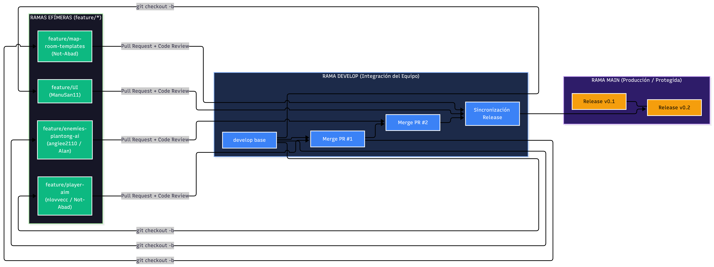

# Guía de Flujo de Trabajo (Workflow & Git Standards)

Este documento define las reglas de colaboración para el equipo. Todos los integrantes deben seguir este ciclo de vida para garantizar entregas estables sin romper el proyecto.

---

## Leyenda de Etiquetas (Labels)

Cada Issue y Pull Request debe estar clasificado con **dos etiquetas**: una de **Área** y una de **Tipo**.

| Categoría | Etiqueta | Descripción |
| :--- | :--- | :--- |
| **Área** | `area:player` | Tareas del personaje jugable y mecánicas de disparo. |
| **Área** | `area:enemies` | Tareas de IA, sprites y atributos de enemigos. |
| **Área** | `area:map` | Tareas de generación procedural y salas. |
| **Área** | `area:ui` | Tareas de menús e interfaz. |
| **Área** | `area:docs` | Tareas de documentación y workflows. |
| **Tipo** | `enhancement` | Nuevas funciones o mecánicas. |
| **Tipo** | `assets` | Importación o ajuste de sprites/animaciones. |
| **Tipo** | `gameplay` | Lógica de física, IA o reglas de juego. |
| **Tipo** | `config` | Ajustes en `project.godot` o mapeo de entradas. |
| **Tipo** | `bug` | Corrección de fallos o errores de código. |

---

## Estrategia de Ramas (Git Branching)

El proyecto utiliza una variante aislada de **Git Flow**:

* **`main`**: Código de versión final de cada iteración.
* **`develop`**: Rama de integración activa. **Todas las ramas personales salen y regresan aquí.**
* **`feature/<modulo>-<descripcion-corta>`**: Ramas individuales para cada Issue atómica.

### Lista de Ramas Personalizadas Generadas por Módulo

Al iniciar una Issue, crea tu rama local siguiendo esta nomenclatura exacta:

#### Módulo Personaje (`feature/player-...`)
* `feature/player-weapon-aim`
* `feature/player-bullet-base`
* `feature/player-bullet-shoot`
* `feature/player-bullet-collision`
* `feature/player-character-atlas`
* `feature/player-character-animations`
* `feature/player-gamepad-controls`

#### Módulo Enemigos (`feature/enemies-...`)
* `feature/enemies-plantong-animations`
* `feature/enemies-plantong-ai`
* `feature/enemies-plantong-health`
* `feature/enemies-plantong-attack`
* `feature/enemies-weight-property`
* `feature/enemies-died-signal`

#### Módulo Mapa (`feature/map-...`)
* `feature/map-room-templates`
* `feature/map-room-placement`
* `feature/map-corridors`
* `feature/map-dungeon-manager`
* `feature/map-room-weights`
* `feature/map-enemy-spawner`

#### Módulo Menú / UI (`feature/ui-...`)
* `feature/ui-main-menu`
* `feature/ui-options-menu`
* `feature/ui-audio-brightness`
* `feature/ui-keybinding-rebind`
* `feature/ui-pause-menu`
* `feature/ui-gamepad-navigation`

---

## Ciclo de Vida de una Issue (Paso a Paso)
### 1. Seleccionar la Issue en GitHub Projects
1. Entra al **[Tablero del Proyecto](https://github.com/users/Not-Abad/projects/1)**.
2. Ve a la columna **Backlog**.
3. Haz clic en la Issue que vas a desarrollar y en el panel lateral derecho asigna tu usuario en **Assignees**.
4. Mueve la tarjeta a la columna **In Progress**.

---

### 2. Crear la Rama en tu entorno local
Abre Git Bash o tu terminal en la carpeta del proyecto y ejecuta:

# 2.1. Asegúrate de tener lo último de develop
    git checkout develop
    git pull origin develop

# 2.2. Crea y cámbiate a tu nueva rama de feature
    git checkout -b feature/enemies-plantong-ai

# 2.3. Desarrollar y realizar Commits atómicos
Trabaja únicamente en los archivos de tu módulo. Realiza commits claros con mensajes descriptivos:

    git add .
    git commit -m "feat(enemies): implementar seguimiento de posición del jugador para Plantong"

# 2.4. Subir la rama y abrir Pull Request (PR)
Cuando completes los Criterios de Aceptación de la Issue:
    git push origin feature/enemies-plantong-ai

    2.4.1. Ve a GitHub y haz clic en Compare & pull request.
    2.4.2. IMPORTANTE: Asegúrate de que la rama base sea develop (no main).
    2.4.3. En la descripción del Pull Request, vincula la Issue usando la palabra clave Closes # o Fixes # seguida del número de la Issue:
        ### Descripción del cambio
        Se implementó el script de persecución en tiempo real hacia la posición global del personaje para Plantong.
        Closes #8
    2.4.5. Pide revisión a un compañero

# 2.5. Finalizar la Issue
Una vez revisado y aprobado el Pull Request:
Se realiza el Merge a la rama develop.
La Issue se cerrará automáticamente y la tarjeta del tablero pasará a Done.
Elimina tu rama remota y local para mantener limpio el repositorio:

    git checkout develop
    git pull origin develop
    git branch -d feature/enemies-plantong-ai
